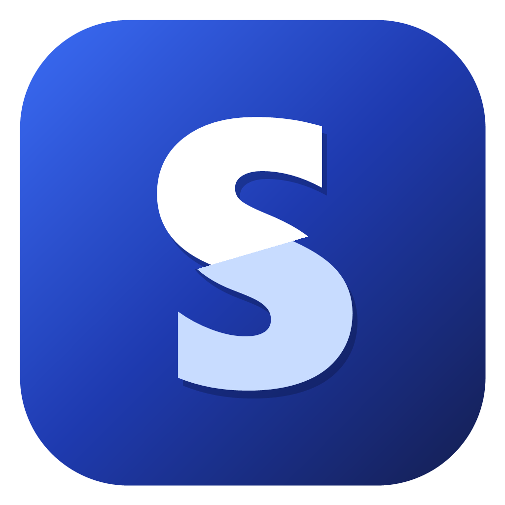
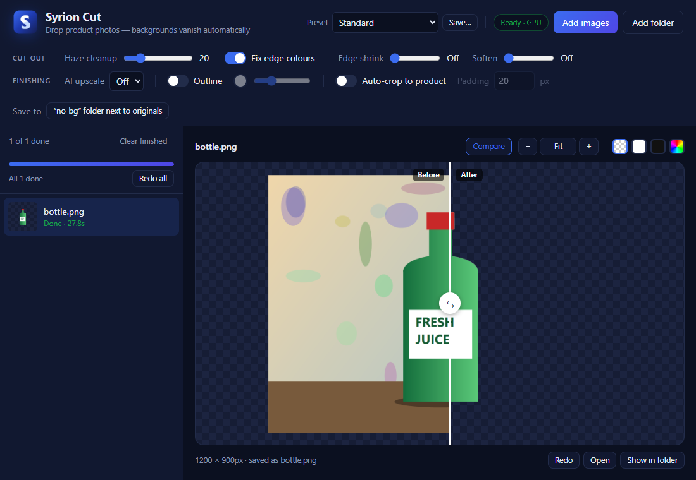
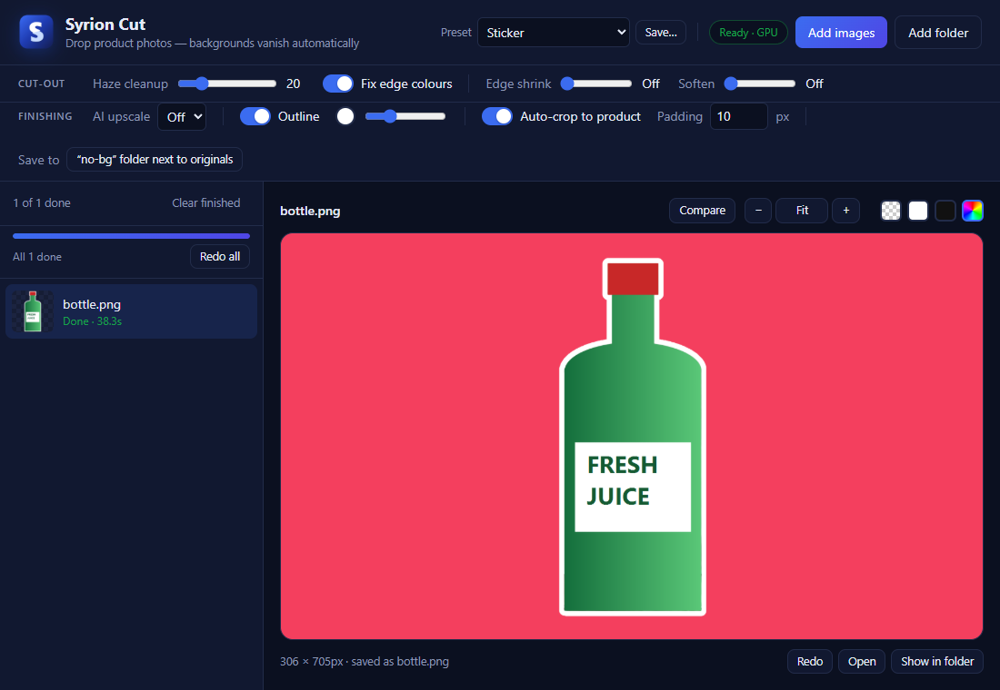

<div align="center">



# Syrion Cut

**Drop in product photos. Get clean, poster-ready transparent PNGs. Offline, on your GPU.**

[](#-download)
[](https://tauri.app)
[](https://github.com/pykeio/ort)
[](#-how-it-works)
[](LICENSE)

[**Download**](#-download) · [**Features**](#-features) · [**How to use**](#-how-to-use) · [**Build from source**](#-build-from-source) · [**FAQ**](#-faq)

<br />



</div>

---

## ✨ Why Syrion Cut?

Clients send product photos with messy backgrounds, and every poster starts with cutting them out by hand. Syrion Cut does it automatically. Drop a folder of photos in and every image comes back as a transparent PNG, with clean edges, ready to place in Photoshop, Illustrator, Canva or Figma.

- **🔒 100% offline.** Your clients' photos never leave your computer. No account, no upload, no subscription, no per-image credits.
- **⚡ Fast.** AI models run on your graphics card through DirectML (NVIDIA, AMD and Intel all work). Most photos take under a second.
- **🎯 Made for design work.** Edge-colour repair, haze cleanup, edge shrink and soften, sticker outlines, and AI upscaling for small client photos.

---

## 🚀 Features

| | Feature | What it does |
|---|---|---|
| 🧠 | **BiRefNet AI** | A high-resolution segmentation model built for the cleanest hair, glass and fine edges. |
| 📦 | **Batch processing** | Drop images *or whole folders*. A progress bar shows time left, and you can **Stop**, **Resume** or **Redo all**. |
| 🎚️ | **Presets** | Built-in looks plus your own saved combos. Pick one and press *Redo all* to restyle a whole job. |
| ↔️ | **Before / after** | Drag a divider across the original and the cut-out, lined up pixel for pixel even after crop, upscale or outline. |
| 🔍 | **Zoom & pan** | Scroll to zoom up to 3200% with crisp pixel view, so you can judge every edge. |
| 🎨 | **Fix edge colours** | Removes the old background colour bleeding into soft edges, so there are no halos on your poster. |
| 🌫️ | **Haze cleanup** | Removes faint leftover shadow or steam and makes the product fully solid. |
| ✂️ | **Edge shrink & soften** | Pull the edge in 1–10px to kill fringes, and feather it so the product blends in naturally. |
| 🔼 | **AI upscale 2× / 4×** | Real-ESRGAN makes small client photos big and sharp enough for print. |
| 🏷️ | **Sticker outline** | Adds a clean outline of any colour and thickness around the product. |
| 📐 | **Auto-crop** | Trims empty space around the product, with adjustable padding. |
| 🖼️ | **Preview backgrounds** | Check the result on checkerboard, white, black or your poster's colour. |

<div align="center">

<br /><sub>The <b>Sticker</b> preset, previewed on a poster colour.</sub>
</div>

---

## 📥 Download

Get the latest **`Syrion Cut_x.y.z_x64-setup.exe`** from the [**Releases page**](../../releases/latest), run it, and you're done. The AI models are included, so nothing else is downloaded.

> **Requirements:** Windows 10 or 11 (64-bit). A DirectX 12 graphics card is recommended; without one, Syrion Cut falls back to the CPU automatically.

> [!NOTE]
> The installer isn't code-signed, so Windows SmartScreen may say *"Windows protected your PC"*. Click **More info → Run anyway**.

---

## 🧭 How to use

1. **Drop** images or folders onto the window, or click **Add images** / **Add folder**.
2. Syrion Cut starts right away. Results are saved as PNGs in a **`no-bg`** folder next to your originals, or in any folder you choose under *Save to*.
3. **Check** each result: press **C** for before/after, scroll to zoom into the edges, and switch the preview background to your poster colour.
4. **Tune** the sliders or pick a preset, then press **Redo** (one image) or **Redo all** (whole batch).

### Built-in presets

| Preset | Best for |
|---|---|
| **Standard** | Everyday product shots |
| **Clean product edges** | Removing thin halos (shrink 1, soften 1, auto-crop) |
| **Glass & see-through** | Bottles, glasses, plastic packaging (keeps transparency) |
| **Small photo → poster** | Tiny WhatsApp-quality photos (4× AI upscale) |
| **Sticker** | Social posts and menus (white outline, auto-crop) |

### Tips

- **Edge shrink 1–2px** removes most fringes. At 3px and up it starts eating into the product.
- **Soften 1–2px** helps photos blend into the poster. Keep it at 0 for crisp packaging.
- Turn **Haze cleanup** down for glass, smoke or steam you *want* to keep.

### Keyboard & mouse

| Action | Control |
|---|---|
| Zoom at cursor | Mouse wheel |
| Pan | Drag |
| 100% ↔ Fit | Double-click, or the **%** button |
| Before / after | **C**, or the **Compare** button |

---

## ⚙️ How it works

```
photo ─► BiRefNet (ONNX, GPU) ─► alpha mask ─► haze cleanup ─► Real-ESRGAN upscale (optional)
      ─► edge shrink / soften ─► edge-colour decontamination ─► auto-crop ─► outline ─► PNG
```

- **App shell:** [Tauri 2](https://tauri.app) with a plain HTML/CSS/JS interface. It's tiny and fast, and no Electron.
- **Inference:** Rust + [`ort`](https://github.com/pykeio/ort) (ONNX Runtime) with the **DirectML** backend, falling back to CPU.
- **Image processing:** written from scratch in Rust: the local-background colour decontamination, separable erode and feather, the exact Euclidean distance transform for outlines, and tiled upscaling with seam-free overlap.

---

## 🛠️ Build from source

**Prerequisites:** [Rust](https://rustup.rs) (stable, MSVC), [Node.js](https://nodejs.org) 18+, and the [Tauri prerequisites for Windows](https://tauri.app/start/prerequisites/) (WebView2 and the VS C++ build tools).

```bash
git clone https://github.com/Doodiez/syrion-cut.git
cd syrion-cut
npm install
```

**Get the AI models.** They're too big for Git, so they're attached to each release as `syrion-cut-models.zip`. Download it from the [Releases page](../../releases/latest) and extract it into `src-tauri/resources/`:

```
src-tauri/resources/
├── birefnet.onnx               (467 MB)
├── real_esrgan_x4plus.onnx     (3 MB)
└── real_esrgan_x4plus.data     (64 MB)
```

Then:

```bash
npm run tauri dev      # run the app
npm run tauri build    # build the installer → src-tauri/target/release/bundle/nsis/
```

> [!TIP]
> If linking fails with `LNK1104` because your path is too long, point Cargo at a short folder in `src-tauri/.cargo/config.toml`:
> ```toml
> [build]
> target-dir = "C:/syrion-cut-build"
> ```

### Command-line mode

The app executable also works headless, which is handy for scripts:

```bash
"Syrion Cut.exe" --cut input.jpg output.png [--crop] [--upscale 2|4] [--outline 6] [--shrink 1] [--soften 1] [--cleanup 20] [--no-fix-edges]
```

---

## ❓ FAQ

<details>
<summary><b>Does it upload my photos anywhere or use any paid AI service?</b></summary>
<br />
No. Everything runs locally on your PC. Syrion Cut makes no network requests, and it works with Wi-Fi off.
</details>

<details>
<summary><b>Why is the installer so big (~450 MB)?</b></summary>
<br />
It contains two AI models. BiRefNet alone is 467 MB before compression. The app itself is only a few MB.
</details>

<details>
<summary><b>The first image is slow?</b></summary>
<br />
The first run loads the model onto your graphics card. After that, images go much faster.
</details>

<details>
<summary><b>Which formats are supported?</b></summary>
<br />
Input: PNG, JPG, WEBP, BMP and TIFF. Output: transparent PNG.
</details>

---

## 📜 License & credits

Syrion Cut's source code is released under the [MIT License](LICENSE).

The AI models are third-party work under their own licenses:

| Model | Used for | Source | License |
|---|---|---|---|
| **BiRefNet** | Background removal | [ZhengPeng7/BiRefNet](https://github.com/ZhengPeng7/BiRefNet) · ONNX by [onnx-community](https://huggingface.co/onnx-community/BiRefNet-ONNX) | MIT |
| **Real-ESRGAN x4plus** | AI upscale | [xinntao/Real-ESRGAN](https://github.com/xinntao/Real-ESRGAN) · ONNX by [Qualcomm AI Hub](https://huggingface.co/qualcomm/Real-ESRGAN-x4plus) | BSD-3-Clause |
| **DirectML** | GPU acceleration | [Microsoft](https://github.com/microsoft/DirectML) | Microsoft DirectML redistributable license |

<div align="center">
<br />
<sub>Made for designers who have better things to do than trace around bottles. 🧃</sub>
</div>
